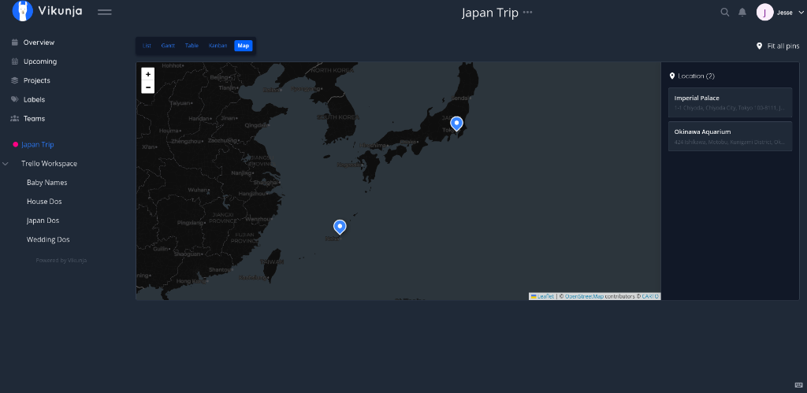
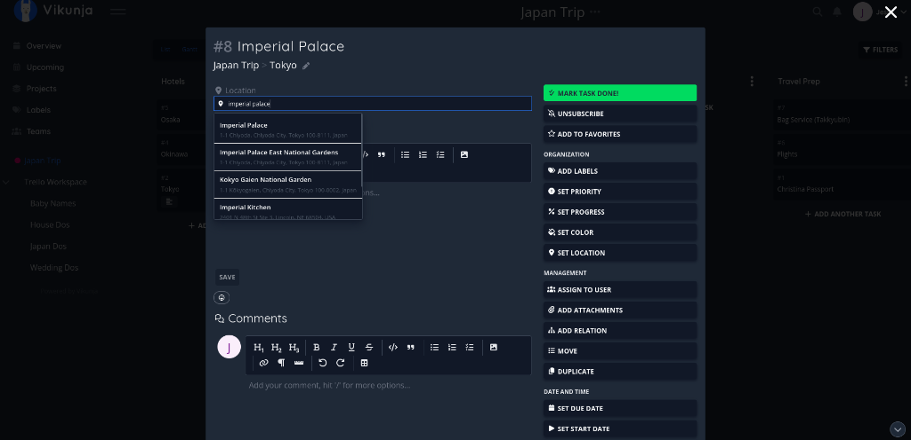
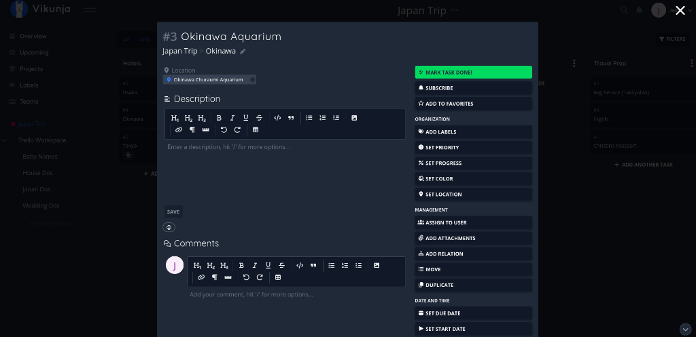

# Vikunja Maps & Location Plugin

A complete **Maps & Location** feature for [Vikunja](https://vikunja.io/), adding work item location search, geocoding autocomplete, and an interactive **OpenStreetMap** project view tab.

Designed for vacation planning, travel itineraries, field service, and geo-tagged task management.



---

## Features

- 📍 **Work Item Location Field**: Autocomplete search directly within task details. Select an address or venue to automatically attach coordinates, display names, and external map links.
- 🗺️ **Interactive Project Map View**: A 5th view tab alongside List, Gantt, Table, and Kanban. Displays an interactive Leaflet/OpenStreetMap canvas with pins for all geocoded project tasks.
- 🔍 **Multiple Geocoding Providers**:
  - **OpenStreetMap Nominatim** *(Default, free, zero API key required)* with OSM usage policy compliance.
  - **Google Places API (New)** *(Optional)* with server-side API key protection.
- 🌓 **Adaptive Dark / Light Themes**: Automatically switches between CARTO Voyager (light) and Dark Matter (dark) tile layers to match your Vikunja theme.
- 💾 **Native Database Persistence**: Uses Vikunja's Yaegi migration plugin system to manage the `task_locations` table across SQLite, PostgreSQL, and MySQL.
- 🧹 **Automatic Cleanup**: Listens to Vikunja's `TaskDeletedEvent` via Watermill to prune location records when tasks are deleted.

---

## How It Works (And Why a Build Is Required)

Vikunja plugins currently only run Go scripts on the backend via the [Yaegi](https://github.com/traefik/yaegi) interpreter. Because Vikunja does not yet have a frontend plugin system, the official Docker image (`vikunja/vikunja:latest`) cannot dynamically load new UI components.

To provide both the **Task Location field** and the **Map view tab**, this repository includes:
1. **The Backend Plugin** (`plugins/maps/main.go`): Exposes geocoding proxies, CRUD endpoints, and DB migrations.
2. **A Core & Frontend Integration Patch** (`vikunja-core-maps.patch`): Adds the `map` view enum and mounts the Vue 3 Leaflet components.

---

## Installation Method 1: Docker (Recommended for Self-Hosters)

**No Go or Node.js required on your host machine.** The included multi-stage `Dockerfile` clones Vikunja, applies the patch, installs Leaflet, and compiles the production container automatically.

### 1. Clone this repository
```bash
git clone https://github.com/jessezetko/vikunja-map-plugin.git
cd vikunja-map-plugin
```

### 2. Start with Docker Compose
```bash
cp docker-compose.example.yml docker-compose.yml
docker compose up -d --build
```

Your custom Vikunja instance with the Maps plugin will be built and accessible at `http://localhost:3456`.

---

## Installation Method 2: Build From Source (For Developers)

If you compile Vikunja locally on bare metal:

### 1. Clone both repositories
```bash
git clone https://github.com/go-vikunja/vikunja.git
git clone https://github.com/jessezetko/vikunja-map-plugin.git
```

### 2. Run the automated installer
```bash
cd vikunja-map-plugin
./install.sh ../vikunja
```

### 3. Build & Run
```bash
cd ../vikunja/frontend
pnpm run build

cd ..
mage build:build
./vikunja
```

---

## Configuration Reference

### Docker Compose Environment Variables
```yaml
environment:
  VIKUNJA_PLUGINS_ENABLED: "true"
  VIKUNJA_PLUGINS_LOADER: "yaegi"
  VIKUNJA_PLUGINS_DIR: "/app/vikunja/plugins"
  # Provider: "nominatim" (default) or "google"
  VIKUNJA_PLUGINS_MAPS_GEOCODER_PROVIDER: "nominatim"
  # VIKUNJA_PLUGINS_MAPS_GOOGLE_API_KEY: "AIzaSy..."
  # CARTO_BASEMAPS_API_KEY: ""
```

### Or in `config.yml`
```yaml
plugins:
  enabled: true
  loader: 'yaegi'
  dir: '/app/vikunja/plugins'
  maps:
    geocoder_provider: 'nominatim' # or 'google'
    # google_api_key: 'AIzaSy...'
    # nominatim_url: 'https://nominatim.openstreetmap.org'
```

---

## How to Use in the Web Interface

### 1. Adding a Location to a Task
1. Open any task in Vikunja to view the task detail modal.
2. In the right-hand sidebar under **Attributes**, click **Set Location** (pin icon).
3. Type an address, landmark, or city into the search input. Suggestions appear automatically via Nominatim or Google Places:



4. Select the location from the dropdown suggestions. The structured coordinates and address are saved immediately.
5. Once saved, a compact location badge appears with an external link to view the coordinates directly on OpenStreetMap:



### 2. Viewing Projects on the Map
1. Navigate to any project.
2. In the project view bar (next to *List*, *Gantt*, *Table*, *Kanban*), click the **`+`** button to add a view.
3. Select **Map** and click **Save**.
4. The interactive map renders pins for all geocoded tasks in the project, complete with pin popups, a list sidebar, and a **Fit all pins** control:


---

## Verification

To verify that the plugin is running properly:
```bash
docker compose logs vikunja | grep -i "maps"
```
You should see:
```text
INFO Loaded plugin maps
INFO Vikunja Maps plugin initialized (provider=nominatim)
```

---

## License & Attribution

This project is licensed under the **GNU Affero General Public License v3.0 (AGPL-3.0)**, matching Vikunja's licensing. See [LICENSE](LICENSE) for details.

### Third-Party Attribution
- **Map Data**: © [OpenStreetMap](https://www.openstreetmap.org/copyright) contributors.
- **Basemap Tiles**: © [CARTO](https://carto.com/attributions).
- **Map Rendering**: [Leaflet](https://leafletjs.com/) (BSD 2-Clause).
